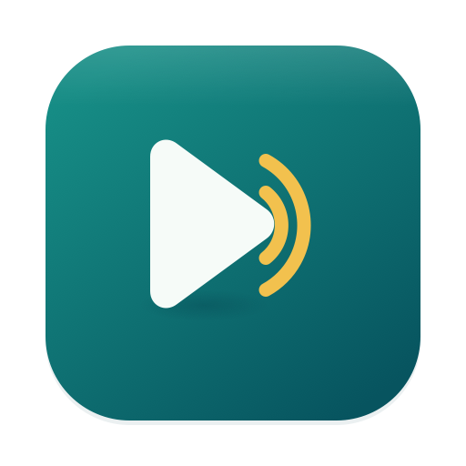

# DooTube



A native Mac app for YouTube and YouTube Music. Rust + AppKit chrome around the official websites. No Electron, no custom player.

## Download

Get **DooTube.dmg** from the [latest release](../../releases/latest) and drag it to Applications. Requires an Apple silicon Mac with macOS 14.2 or later.

The app isn't notarized, so macOS blocks the first launch. Open System Settings → Privacy & Security and click **Open Anyway**, or run:

```sh
xattr -dr com.apple.quarantine /Applications/DooTube.app
```

## Features

- **YouTube and Music** in separate sections (⌘1 / ⌘2). Only one plays at a time.
- **Native toolbar and sidebar** replace the sites' own headers. The player is untouched.
- **Google sign-in** in the app. The toolbar shows your account photo.
- **Up Next**: save videos with ⌘S, then reorder or remove them in the sidebar.
- **Now Playing**: while you browse YouTube, the sidebar shows what YouTube Music is playing, with play/pause, next, and previous. The Controls menu works from either section.
- **Video full screen**: press F and the video zooms out to fill the screen. Press F or Esc to zoom back.
- **Picture in Picture** (⌃⌘P). Keeps playing while the app is hidden.

| Shortcut | Action |
| --- | --- |
| ⌘L | Search |
| ⌘[ / ⌘] | Back / Forward |
| ⇧⌘H | Home |
| ⌘R | Reload |
| ⌘P | Music: Play / Pause |
| ⌘← / ⌘→ | Music: Previous / Next |
| ⌃⌘S | Toggle sidebar |
| ⌃⌘F | Window full screen |

Passkeys can't be used in embedded web views, so Google asks for your password or another verification method instead.

## Build from source

Requires Rust and Xcode Command Line Tools.

```sh
./scripts/run.sh            # debug build and launch
./scripts/install.sh --open # optimized build into /Applications
./scripts/make-dmg.sh       # target/DooTube.dmg
```

## More

[Implementation](docs/implementation.md) · [Verification](docs/verification.md) · [Changelog](CHANGELOG.md)
